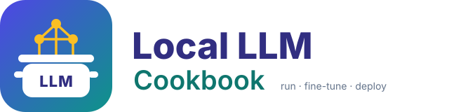

<p align="center">
  
</p>

<p align="center">
  <strong>Learn to run, fine-tune, and deploy Large Language Models on your own hardware.</strong>
</p>

<p align="center">
  
  
  
  
</p>

<p align="center">
  <a href="docs/getting-started.md">Getting Started</a> ·
  <a href="docs/hardware-guide.md">Hardware Guide</a> ·
  <a href="docs/model-selection.md">Model Selection</a> ·
  <a href="docs/quantization.md">Quantization</a> ·
  <a href="CONTRIBUTING.md">Contribute</a>
</p>

---

Local LLM Cookbook is an open-source, practical learning resource for building and experimenting with local AI, from running your first language model to fine-tuning and deployment.

No cloud inference APIs. No unnecessary complexity. Just practical knowledge, reproducible examples, and honest hardware guidance.

## Table of Contents

- [Quick Start](#quick-start)
- [Our Mission](#our-mission)
- [Why This Project?](#why-this-project)
- [Who Is This For?](#who-is-this-for)
- [Learning Path](#learning-path)
- [What You'll Explore](#what-youll-explore)
- [Hardware Matters](#hardware-matters)
- [Tools & Ecosystem](#tools--ecosystem)
- [Explore the Documentation](#explore-the-documentation)
- [Examples & Guides](#examples--guides)
- [FAQ](#faq)
- [Contributing](#contributing)
- [Project Roadmap](#project-roadmap)
- [License](#license)

## Quick Start

Run your first local model in about five minutes.

1. Install [Ollama](https://ollama.com/download) (or [LM Studio](https://lmstudio.ai/) if you prefer a desktop app).
2. Pull and run a small model:

```bash
ollama run llama3.2:3b
```

3. Start chatting. Everything runs on your machine, and nothing leaves it.

Small models (1B to 4B parameters) run on most modern laptops. Browse the [Ollama library](https://ollama.com/library) for other models, then read the [Hardware Guide](docs/hardware-guide.md) to pick one that fits your machine.

## Our Mission

Make local Large Language Models accessible to everyone.

We believe developers, students, researchers, and AI enthusiasts should be able to understand, run, and experiment with modern language models using their own hardware.

## Why This Project?

Getting started with local AI can be confusing. Hardware requirements are often unclear, tutorials go out of date quickly, and the difference between running a model and training one is rarely explained properly.

This project addresses those problems through:

- Practical, step-by-step tutorials.
- Realistic hardware recommendations.
- Reproducible code examples and configurations.
- Clear explanations of local inference and fine-tuning.
- Open-source tools and community-driven knowledge.

## Who Is This For?

- **Beginners** learning about local AI and LLMs.
- **Developers** building applications powered by local models.
- **Students and researchers** exploring machine learning.
- **AI enthusiasts** experimenting with open-weight models.
- **Hardware-conscious users** who want to know what their computers can realistically handle.

## Learning Path

New here? Follow this order.

| Step | Goal | Start with |
|---|---|---|
| 1. Run | Get a model answering prompts locally | [Getting Started](docs/getting-started.md) |
| 2. Size | Learn what your hardware can handle | [Hardware Guide](docs/hardware-guide.md) |
| 3. Choose | Pick the right model for your task | [Model Selection](docs/model-selection.md) |
| 4. Shrink | Fit bigger models into less memory | [Quantization Guide](docs/quantization.md) |
| 5. Adapt | Fine-tune a small model with LoRA or QLoRA | `examples/` |
| 6. Ship | Export to GGUF and deploy | `guides/` |

## What You'll Explore

| Area | Topics |
|---|---|
| Local inference | Running models with Ollama, LM Studio, and llama.cpp |
| Model selection | Choosing models based on hardware and use cases |
| Quantization | GGUF, GPTQ, AWQ, and memory optimization |
| Fine-tuning | LoRA, QLoRA, Unsloth, and LLaMA-Factory |
| Development | Building applications with local model inference |
| Deployment | Model conversion, GGUF export, and deployment workflows |

## Hardware Matters

Not every model runs on every computer. RAM, GPU VRAM, processor, storage, quantization, and context length all affect performance.

As a rough rule of thumb, a 4-bit quantized model needs about 0.5 to 0.7 GB of memory per billion parameters, plus extra for the context window. Treat these as ballpark figures, not guarantees:

| Your machine | Realistic starting point |
|---|---|
| 8 GB RAM, no GPU | Small models, roughly 1B to 3B |
| 16 GB RAM, no GPU | 7B to 8B at 4-bit (slow but usable) |
| 8 GB VRAM GPU | 7B to 8B at 4-bit, comfortably |
| 16 GB VRAM GPU | Up to about 14B at 4-bit |
| 24 GB VRAM GPU | Up to about 30B at 4-bit |

This project distinguishes between:

- Running an existing model (inference).
- Adapting a model with additional training (fine-tuning).
- Training a model from scratch.

A machine that can run a quantized model cannot necessarily fine-tune it. Fine-tuning needs noticeably more memory than inference, which is why QLoRA exists. We document practical limits instead of making unrealistic hardware promises.

## Tools & Ecosystem

- [Ollama](https://ollama.com/): local model runtime.
- [LM Studio](https://lmstudio.ai/): desktop application for local inference.
- [llama.cpp](https://github.com/ggml-org/llama.cpp): the C/C++ inference engine behind much of the GGUF ecosystem.
- [Unsloth](https://unsloth.ai/): efficient model fine-tuning.
- [LLaMA-Factory](https://github.com/hiyouga/LLaMA-Factory): model fine-tuning framework.
- [Hugging Face](https://huggingface.co/): models, datasets, and the wider ML ecosystem.
- [GGUF](https://github.com/ggml-org/ggml): model file format used across local inference tools.

## Explore the Documentation

- [Getting Started](docs/getting-started.md)
- [Hardware Guide](docs/hardware-guide.md)
- [Model Selection](docs/model-selection.md)
- [Quantization Guide](docs/quantization.md)
- [Glossary](docs/glossary.md)
- [Troubleshooting](docs/troubleshooting.md)
- [Repository Structure](docs/repository-structure.md)

## Examples & Guides

- `guides/`: step-by-step tool and workflow tutorials.
- `examples/`: practical inference, fine-tuning, and deployment examples.
- `configs/`: reusable training configurations.
- `scripts/`: setup and environment validation utilities.

See the [Repository Structure](STRUCTURE.md) for the full layout.

## FAQ

**Do I need a GPU?**
No. Small and mid-size quantized models run on CPU, just more slowly. A GPU makes things much faster.

**Is local really free and private?**
Running models locally has no per-token cost and your prompts stay on your machine. You still pay for hardware and electricity.

**Can I fine-tune on my laptop?**
Small models with QLoRA, sometimes. It depends heavily on your VRAM. See the [Hardware Guide](docs/hardware-guide.md) for realistic limits.

**Which model should I start with?**
Pick the largest model that fits comfortably in your memory, then compare it against a smaller one on your own task. [Model Selection](docs/model-selection.md) explains how.

## Contributing

Local LLM Cookbook is a community project and contributions are welcome. You can fix documentation, add a tutorial, report how a model performs on your hardware, or contribute code. Hardware test reports are especially valuable.

Read the [Contributing Guide](CONTRIBUTING.md) to get started. If this project helps you, a star on GitHub helps others find it.

## Project Roadmap

- [ ] Complete foundational documentation.
- [ ] Publish practical local inference tutorials.
- [ ] Document hardware-specific model recommendations.
- [ ] Add reproducible inference examples.
- [ ] Develop small-model fine-tuning examples.
- [ ] Document model conversion and deployment.
- [ ] Expand hardware compatibility and troubleshooting guidance.
- [ ] Welcome community contributions.

## License

See [LICENSE](LICENSE) for the project's licensing terms.

Models, datasets, libraries, and third-party tools referenced in this repository may have separate licenses and usage restrictions.